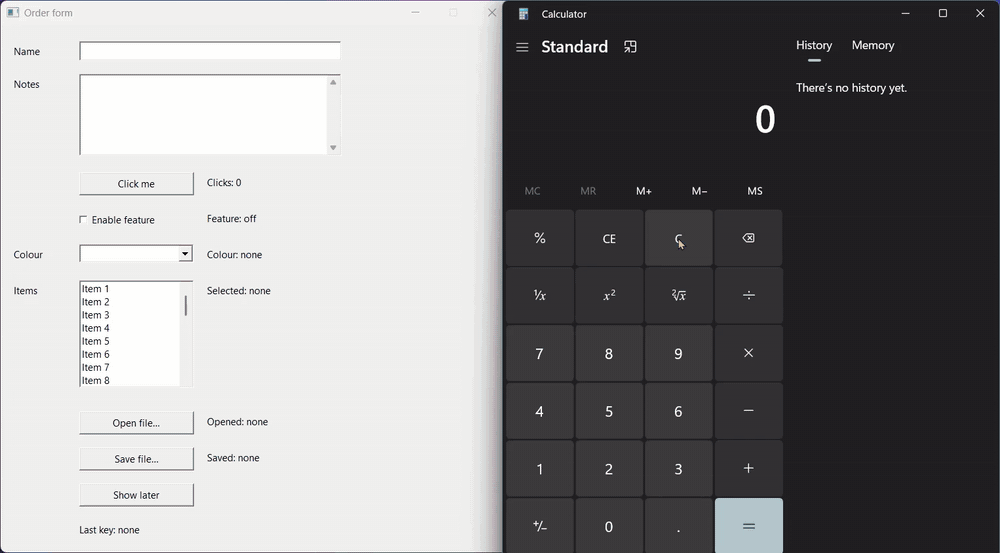

# WinPilot

An MCP server that lets AI agents use a Windows PC: read apps, click, type, fill forms, record the screen and listen to audio. Written in Rust, runs locally, nothing leaves the machine.



## Install

1. Download `winpilot-0.1.0-windows-x64.zip` from [Releases](../../releases) and unzip it, for example to `%LOCALAPPDATA%\Programs\winpilot`.
2. Register it with Claude Code:

   ```powershell
   claude mcp add -s user winpilot -- "$env:LOCALAPPDATA\Programs\winpilot\winpilot.exe" mcp
   ```

3. Restart Claude Code, or run `/mcp`. Any other MCP client works the same way: the command is `winpilot.exe mcp`.

From WSL, point Claude Code in the distro at the same Windows exe:

```bash
claude mcp add -s user winpilot -- /mnt/c/Users/<you>/AppData/Local/Programs/winpilot/winpilot.exe mcp
```

Paths under `/mnt/c/...` are translated to `C:\...`. Files that live only inside WSL (like `/home/...`) have to be copied under `/mnt/c` first, so WinPilot's deny list always applies.

From source (Rust and the VS Build Tools): `.\scripts\install.ps1 -Register`.

For `listen` (speech-to-text), download the model once: `.\scripts\install.ps1 -SpeechModel base`.

## Use it

Ask your agent in plain words:

- "Open Calculator and work out 128 × 46."
- "Fill in the form in the Order app and save it to Downloads."
- "Attach report.pdf in the upload dialog."
- "Record my screen with sound for 30 seconds."
- "What are they saying in this video?"
- "Do it in the background, I'm using the PC."

The agent gets two tools:

| Tool | What it does |
|---|---|
| `observe` | `elements`, `text`, `screenshot`, `record`, `listen`, `windows`, `monitors`, `apps`, `clipboard`, `status` |
| `act` | up to 50 steps per call: `click`, `type`, `key`, `mouse`, `set`, `focus`, `window`, `pick`, `wait`, `clipboard`, `notify` |

Apps are read through UI Automation. Apps without it (CapCut, games, canvases) are read with OCR and targeted by text, like `ocr:"Export"`.

With `background: true` the agent works behind your windows: no mouse, no keyboard, no focus change. Ctrl/Alt/Shift shortcuts still need the foreground.

## Safety

- **Ctrl+Alt+Esc** stops all input at once. Press it again to resume.
- It never touches its own terminal, password managers, admin windows or UAC prompts.
- It waits while you are using the mouse or keyboard.
- An overlay shows what the agent is doing, and where.

## Config

`%APPDATA%\winpilot\config.toml`, all optional:

```toml
[guard]
deny = [{ process = "keepass.exe" }, { title = "Bank" }]
deny_paths = ['D:\Private']

[act]
background = false

[overlay]
enabled = true
```

## Develop

```powershell
.\scripts\check.ps1          # fmt, clippy, tests
.\scripts\install.ps1        # build and install
```

How it is put together: [PLAN.md](PLAN.md).

MIT License.
